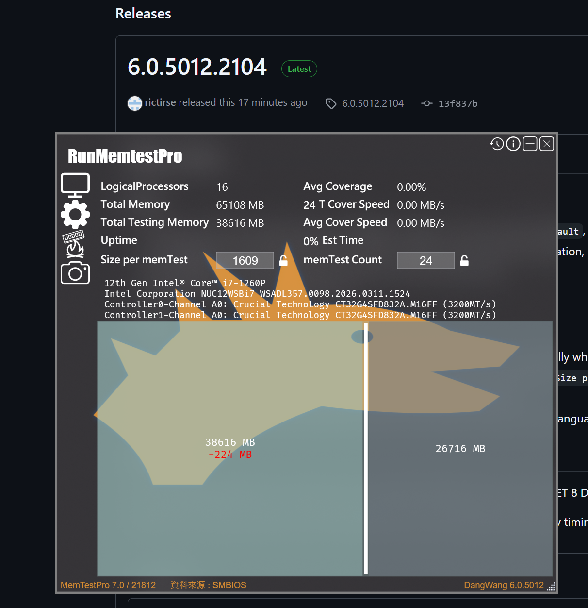

# RunMemtestPro

**English** | [中文](#中文)

**RunMemtestPro** is a memory burn-in tool that runs many MemTest instances at once, fills free memory automatically, and shows coverage, errors and memory details in one window.

This repository (RunMemtestStartup) contains only the launcher. The launcher carries the RunMemtestPro program inside a single download; when started, it extracts the program to a temporary folder and runs it.

## Requirements

- Windows 10 / 11 (x64)
- [.NET 8 Desktop Runtime (x64)](https://dotnet.microsoft.com/download/dotnet/8.0)
- **MemTest / MemTest Pro** by HCI Design (not included — use your own copy). Versions 4.1 to 7.0 are recognized.
- Optional: **CPU-Z** (`cpuz_x64.exe`) for detailed memory timings

## Quick Start

1. Download `RunMemtestStartup_<version>.zip` from [Releases](../../releases) and extract it to a folder.
2. Put your MemTest executable (for example `memtest.exe` or `memTestPro70.exe`) in the **same folder**.
3. Optional: put `cpuz_x64.exe` in the same folder.
4. Run `RunMemtestStartup.exe`. To use CPU-Z, right-click it and choose **Run as administrator**.
5. RunMemtestPro calculates how many MemTest instances to open and how much memory each one uses, based on your free memory and CPU threads.
6. Click **Burn** to start. Click **Stop** to end the test, then click **Clear results**.

## How to Use

### Burn-in test
- Each cell in the grid is one MemTest instance. The bar inside a cell shows its coverage; it turns darker after 100%. Hover over a cell for details.
- A cell turns **red** when that instance reports an error or its process closes unexpectedly.
- The burn button cycles through **Burn → Stop → Clear results**. It cannot be clicked while the instances are still opening.

### Memory bar
- The bar at the bottom shows three parts: memory used by MemTest, free memory, and memory used by the system.
- Drag the bar to change the total MemTest size, and double-click it to recalculate.
- The two lock buttons fix either the total size or the number of instances while you adjust the other.
- A red negative number means the planned size is larger than the memory currently free.

### Settings
- **Screenshots**: take one manually, every N minutes, or automatically when the error count exceeds a threshold (the test also stops).
- **When the test completes**: stop at a coverage percentage or after a number of minutes, then take a screenshot, close MemTest, and optionally shut down or restart.
- **Language** and **MemTest version** (when several versions are in the folder) can be switched.
- **Style (skin)**: choose `Default`, `ROG`, `ROG2`, `MSI` or `Gskill`. The change applies immediately and is saved.

### Where files are saved
- Settings (`appsettings.json`), screenshots and logs are saved in the folder where `RunMemtestStartup.exe` is.
- The program itself is extracted to `%TEMP%\RunMemtest\<version>-<id>`. It is safe to delete; it is extracted again on the next start.

## Memory Information: SMBIOS vs. CPU-Z

RunMemtestPro reads memory information in two ways. The current source is shown in the information area as **Data source : …**.

| | SMBIOS (default) | CPU-Z External |
|---|---|---|
| Shown as | `Data source : SMBIOS` | `Data source : CPU-Z External` |
| Needs | Nothing extra | `cpuz_x64.exe` in the same folder **and** running as administrator |
| Information | CPU, motherboard and BIOS; for each memory module: slot, manufacturer, part number and speed (MT/s) | Everything from SMBIOS, plus one extra line with the DRAM frequency and timings |
| Example extra line | — | `Dram Freq:1596.1 MHz (1:12) 22-22-22-52,560 1T` |
| Speed | Immediate | About 10–30 seconds after start-up |

- **SMBIOS** is read from the motherboard firmware and is always available. When the firmware reports the manufacturer as blank or `Unknown`, the JEDEC manufacturer code of the module is used instead.
- **CPU-Z External** runs CPU-Z in the background, reads its report, and adds the timings: frequency, divider, CL-tRCD-tRP-tRAS, tRFC and command rate. If CPU-Z is not found or the program is not running as administrator, RunMemtestPro stays on SMBIOS.

---

## 中文

**RunMemtestPro** 是記憶體燒機工具：同時開啟多個 MemTest，自動吃滿可用記憶體，並在同一個視窗顯示覆蓋率、錯誤數和記憶體資訊。

這個 repo（RunMemtestStartup）只有啟動器。啟動器把 RunMemtestPro 主程式包在同一個下載檔裡，執行時先解壓到暫存資料夾，再啟動主程式。

## 需求

- Windows 10／11（x64）
- [.NET 8 Desktop Runtime（x64）](https://dotnet.microsoft.com/download/dotnet/8.0)
- HCI Design 的 **MemTest／MemTest Pro**（不附，請使用自己的版本），可辨識 4.1～7.0
- 選用：**CPU-Z**（`cpuz_x64.exe`），用來顯示詳細的記憶體時序

## 快速開始

1. 從 [Releases](../../releases) 下載 `RunMemtestStartup_<版本>.zip`，解壓縮到一個資料夾。
2. 把 MemTest 執行檔（例如 `memtest.exe` 或 `memTestPro70.exe`）放進**同一個資料夾**。
3. 選用：把 `cpuz_x64.exe` 也放進同一個資料夾。
4. 執行 `RunMemtestStartup.exe`。要使用 CPU-Z，請按右鍵選「**以系統管理員身分執行**」。
5. RunMemtestPro 會依可用記憶體和 CPU 執行緒數，自動算出要開幾個 MemTest，以及每個用多少記憶體。
6. 按「**燒機**」開始。按「**停止**」結束測試，再按「**清除燒機結果**」。

## 使用方法

### 燒機
- 格子裡每一格是一個 MemTest。格子裡的進度條是該 MemTest 的覆蓋率，超過 100% 後顏色會變深。滑鼠移到格子上可以看詳細資訊。
- 某個 MemTest 回報錯誤，或它的程式意外關閉時，那一格會變**紅色**。
- 燒機按鈕依序是「**燒機 → 停止 → 清除燒機結果**」。MemTest 還在開啟時，按鈕暫時不能按。

### 記憶體條
- 下方的記憶體條分成三段：MemTest 使用量、剩餘記憶體、系統使用量。
- 拖曳記憶體條可以調整 MemTest 的總使用量，雙擊會重新計算。
- 兩顆鎖頭按鈕可以分別鎖定總大小或開啟數量，只調整另一個。
- 紅色的負數代表預計使用量比目前可用的記憶體還多。

### 設定
- **截圖**：可以手動截圖、每 N 分鐘自動截圖，或錯誤數超過門檻時自動截圖，同時停止燒機。
- **測試完成時**：達到指定的覆蓋率或分鐘數時停止，然後截圖、關閉 MemTest，也可以設定關機或重開機。
- 可以切換**語言**；資料夾裡有多個 MemTest 版本時，也可以切換 **MemTest 版本**。
- **外觀（Style）**：可選 `Default`、`ROG`、`ROG2`、`MSI`、`Gskill`，選了馬上套用並自動存檔。

### 檔案存在哪裡
- 設定（`appsettings.json`）、截圖和 Log 都存在 `RunMemtestStartup.exe` 所在的資料夾。
- 主程式解壓在 `%TEMP%\RunMemtest\<版本>-<識別碼>`。可以放心刪除，下次啟動會重新解壓。

## 記憶體資訊：SMBIOS 與 CPU-Z 的差別

RunMemtestPro 有兩種讀取記憶體資訊的方式。目前用的是哪一種，會在資訊區顯示為「**資料來源 : …**」。

| | SMBIOS（預設） | CPU-Z External |
|---|---|---|
| 顯示 | `資料來源 : SMBIOS` | `資料來源 : CPU-Z External` |
| 需要 | 不需要額外的東西 | 同一個資料夾有 `cpuz_x64.exe`，**而且**以系統管理員身分執行 |
| 內容 | CPU、主機板與 BIOS；每條記憶體的插槽、製造商、型號、速度（MT/s） | SMBIOS 的全部內容，再多一行 DRAM 頻率與時序 |
| 多出來的那行（範例） | — | `Dram Freq:1596.1 MHz (1:12) 22-22-22-52,560 1T` |
| 速度 | 立即 | 啟動後約 10～30 秒 |

- **SMBIOS** 從主機板韌體讀取，一定有。韌體回報的製造商是空白或 `Unknown` 時，會改用記憶體模組的 JEDEC 廠商代碼判斷。
- **CPU-Z External** 會在背景執行 CPU-Z、讀取它的報告，再補上時序：頻率、除頻比、CL-tRCD-tRP-tRAS、tRFC 和 Command Rate。找不到 CPU-Z，或沒有用系統管理員身分執行時，會維持 SMBIOS。
